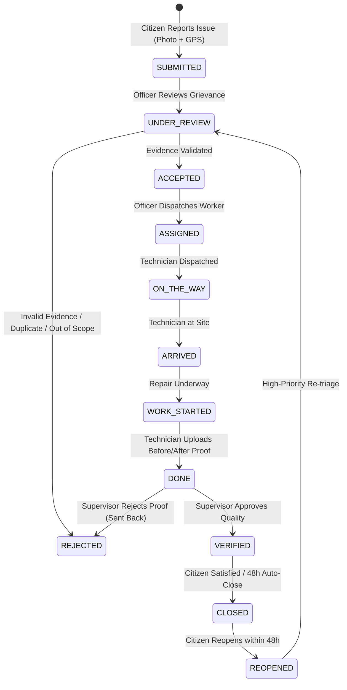

# SmartCivic — Intelligent Municipal Issue Reporting & Rapid Redressal System

> **Semester-5 Open Source Technologies (OST) Project**  
> A high-reliability, evidence-backed, location-aware civic grievance lifecycle platform connecting citizens, municipal department officers, field crews, supervisors, and administrative leadership.

---

## 🌟 Executive Summary

Traditional civic complaint helplines suffer from opaque handling, lack of verifiable evidence, unmeasured delays, and citizen disillusionment. **SmartCivic** modernizes municipal administration through:

1. **Evidence-Driven Intake**: GPS-geotagged photo evidence, fast multi-tier reverse geocoding, and duplicate-aware grievance tracking.
2. **Strict 5-Tier Role-Based Access Control (RBAC)**: Dedicated operational workspaces for Citizens, Department Officers, Field Technicians, Quality Supervisors, and Municipal Administrators.
3. **Immutable 10-Stage State Machine**: Enforces proof at every lifecycle transition, culminating in mandatory before-and-after photographic verification.
4. **Statutory SLA Matrix & Breach Escalation**: Real-time SLA countdown timers with automated warnings and breach flags.
5. **Spatial GIS Intelligence**: Ward-level heatmaps and clustering on interactive OpenStreetMap/Leaflet interfaces.
6. **Immutable Forensic Audit Ledger**: Tamper-evident logging of every state change, actor ID, remarks, and IP address.

---

## 🏗️ Architecture & Monorepo Structure

```
smart-city-issue-reporting/
├── backend/                       # Python 3.12+ / Django 5.x / DRF
│   ├── smartcivic/                # Core Django project settings, JWT & WSGI/ASGI
│   ├── accounts/                  # Custom User model, RBAC, registration & profile APIs
│   ├── departments/               # Municipal departments, ward mappings & routing engine
│   ├── issues/                    # Grievance lifecycle state machine & triage APIs
│   ├── evidence/                  # Photo/file storage, before/after proof handling
│   ├── ai/                        # Issue category suggestion & priority heuristics
│   ├── notifications/             # In-app notification engine & polling alerts
│   ├── analytics/                 # Ward KPIs, SLA compliance & breakdown metrics
│   ├── audit/                     # Immutable status transition ledger
│   ├── media/                     # Uploaded citizen evidence & repair verification photos
│   ├── requirements.txt           # Python backend dependencies
│   └── manage.py
├── frontend/                      # React 18 / TypeScript / Vite / Tailwind CSS
│   ├── src/
│   │   ├── components/
│   │   │   ├── auth/              # Protected routes & quick role-switch modal
│   │   │   ├── layout/            # Responsive AppShell, role-specific sidebars & dropdowns
│   │   │   ├── location/          # Fast reverse-geocoding Leaflet LocationPicker & GIS Maps
│   │   │   └── ui/                # Custom cards, badges, buttons, drawers & modals
│   │   ├── pages/
│   │   │   ├── HomePage.tsx       # Landing portal, public statistics & quick tracker
│   │   │   ├── LoginPage.tsx      # Multi-role authentication portal
│   │   │   ├── RegisterPage.tsx   # Role & department self-registration
│   │   │   ├── ReportIssuePage.tsx# Geotagged issue submission workflow
│   │   │   ├── TrackIssuePage.tsx # Public reference tracker with milestone timeline
│   │   │   └── dashboards/        # Role-specific operational command desks
│   │   │       ├── CitizenDashboard.tsx     # Citizen grievance history & feedback
│   │   │       ├── OfficerDashboard.tsx     # Department triage queue & work orders
│   │   │       ├── WorkerDashboard.tsx      # Field technician tasks & proof uploads
│   │   │       ├── SupervisorDashboard.tsx  # Quality audit & verification approvals
│   │   │       └── AdminDashboard.tsx       # Citywide analytics, routing & audit logs
│   │   ├── context/               # AuthContext & global state providers
│   │   ├── services/api.ts        # Axios/Fetch API client with token auto-refresh
│   │   └── types/                 # Shared TypeScript interfaces (Issues, Users, SLAs)
│   ├── public/images/             # High-resolution local civic assets & category photos
│   └── package.json
└── docs/                          # Specifications & architecture references
```

---

## 👥 5-Tier Role-Based Access Control (RBAC)

| Role | Operational Scope | Dedicated Sidebar Navigation | Primary Actions |
|---|---|---|---|
| **Citizen** | Public Grievance Filing | • All My Grievances<br>• In Progress / Active<br>• Resolved Tickets<br>• File New Grievance<br>• Track Reference ID | File GPS-pinned reports, upload photos, track resolution timeline, submit 1–5 star ratings, reopen unsatisfied tickets within 48h. |
| **Department Officer** | Departmental Command Desk (Roads, Water, Electrical, Sanitation, Traffic, Parks) | • Command Triage Desk<br>• New Intake (Pending)<br>• SLA Breaches & Alerts<br>• Field Crew Dispatches<br>• Ward GIS & Heatmap<br>• Track Reference ID | Review evidence, accept or formally reject with cause, set SLA priority, reroute to other departments, assign work orders to field technicians. |
| **Field Technician** | On-Site Maintenance & Repair Crew | • Active Work Orders<br>• Completed Repairs<br>• Track Reference ID | Navigate to GPS location, update dispatch status (`Arrived`, `Work Started`), upload before-and-after photo evidence with repair notes. |
| **Field Supervisor** | Independent Quality Audit | • Quality Verification Desk<br>• Track Reference ID | Inspect field repair proof submitted by technicians, approve final closure, or reject back for rework. |
| **Municipal / System Admin** | Citywide Governance & Oversight | • City Grievance Master<br>• GIS Hotspot Analysis<br>• Citywide Analytics<br>• Automated Routing Engine<br>• Department SLA Matrix<br>• Security & Audit Ledger | Reconfigure category routing rules, tune statutory SLA matrices, audit immutable forensic event trails, monitor inter-ward compliance. |

---

## 🔑 Pre-Configured Demo Credentials

All test accounts use the password: **`pass123`**

| Role | Username | Password | Full Name | Department / Assignment |
|---|---|---|---|---|
| **Municipal Admin** | `admin` | `pass123` | Kavita Rao | Central Municipal Governance |
| **Department Officer** | `officer` | `pass123` | Vikram Deshmukh | Roads & Infrastructure (`ROADS`) |
| **Department Officer** | `officer_water` | `pass123` | Mahesh Jadhav | Water Supply & Sewerage (`WATER`) |
| **Department Officer** | `officer_elec` | `pass123` | Suresh Rane | Electrical & Lighting (`ELEC`) |
| **Department Officer** | `officer_san` | `pass123` | Anita Gupta | Solid Waste & Sanitation (`SAN`) |
| **Field Supervisor** | `supervisor` | `pass123` | Anjali Patil | Roads & Infrastructure |
| **Field Supervisor** | `sup_water` | `pass123` | Dinesh Kulkarni | Water Supply & Sewerage |
| **Field Technician** | `worker` | `pass123` | Rajesh Kumar | Roads & Infrastructure |
| **Field Technician** | `worker_water` | `pass123` | Ganesh Pawar | Water Supply & Sewerage |
| **Field Technician** | `worker_elec` | `pass123` | Ramesh Nair | Electrical & Lighting |
| **Public Citizen** | Self-register | Any | Custom User | Public Citizen Portal |

*(You can also use the interactive **"Demo Role Switcher"** modal on the `/login` screen to sign in with one click.)*

---

## 🔄 Issue Lifecycle State Machine



---

## ⏱️ Statutory Service Level Agreement (SLA) Matrix

| Priority Class | Target Response | Statutory Resolution Deadline | Escalation Warning Threshold | Typical Civic Scenarios |
|---|---|---|---|---|
| **Critical** | Within 1 Hour | **6 Hours** | At 75% elapsed (4.5h) | Active pipeline bursts, exposed high-voltage cables, major sinkholes. |
| **High** | Within 2 Hours | **24 Hours** | At 80% elapsed (19h) | Overflowing sewage, primary arterial pothole clusters, dead traffic signals. |
| **Medium** | Within 4 Hours | **48 Hours** | At 80% elapsed (38h) | Non-functional street lights, damaged footpaths, missed community dumpsters. |
| **Low** | Within 8 Hours | **72 Hours** | At 85% elapsed (61h) | Faded lane markings, tree pruning requests, park bench repairs. |

---

## 🎨 Design System & Palette (Strict Government-Grade Standards)

- **Typography**:
  - Headings & Display: `Plus Jakarta Sans` (Bold 700 / Semi-Bold 600)
  - Interface, Body & Identifiers: `Inter` (Regular 400 / Medium 500 / Semi-Bold 600 / Bold 700) - clean, professional humanist sans-serif without robotic dotted zeros
- **Harmonious Palette**:
  - Primary Civic Teal: `primary-700` (`#0B5F63`), `primary-600` (`#0E7378`), `primary-100` (`#D9F0EF`)
  - Accent Gold: `accent-500` (`#E8A317`)
  - Ink Scales: `ink-950` (`#0A1A2A`), `ink-700` (`#243B53`), `ink-500` (`#52667A`), `ink-300` (`#A7B4C2`)
  - Backgrounds: `surface` (`#F5F7FA`), `card` (`#FFFFFF`), `line` (`#E2E8EF`)
- **Status Lifecycle Tokens**:
  - Submitted: `#64748B` | Under Review: `#2F6FDE` | Accepted: `#0E7378` | Assigned: `#0369A1`
  - In Progress: `#A16207` | Done / Verified: `#15803D` | Rejected: `#C2410C` | Reopened: `#BE123C`

---

## 🚀 Quickstart Guide

### Prerequisites
- Python 3.11+ or 3.12+
- Node.js 18+ or 20+ & npm
- Git

---

### Step 1: Clone the Repository
```powershell
git clone https://github.com/Parth-donda/smart-city-issue-reporting.git
cd smart-city-issue-reporting
```

---

### Step 2: Backend Setup (Django + DRF)

```powershell
# Navigate to the backend directory
cd backend

# Create and activate a Python virtual environment
python -m venv venv
.\venv\Scripts\Activate.ps1   # On macOS/Linux: source venv/bin/activate

# Install required backend dependencies
pip install -r requirements.txt

# Run database migrations
python manage.py migrate

# (Optional) Verify backend tests
python manage.py test

# Launch the Django backend server (runs at http://127.0.0.1:8000/)
python manage.py runserver
```

---

### Step 3: Frontend Setup (React + Vite + TypeScript)

Open a new terminal window:

```powershell
# Navigate to the frontend directory
cd frontend

# Install npm dependencies
npm install

# (Optional) Run TypeScript typecheck & production build
npm run build

# Start the Vite development server (runs at http://localhost:5173/)
npm run dev
```

---

## 📡 Key REST API Specifications

| Method | Endpoint | Auth Required | Description |
|---|---|---|---|
| `POST` | `/api/auth/login/` | No | Authenticate user & return JWT access/refresh token pair |
| `POST` | `/api/auth/register/` | No | Register citizen, officer, or field worker with auto-profile creation |
| `GET` | `/api/auth/me/` | Bearer | Retrieve authenticated user profile, role, and department code |
| `GET` | `/api/issues/` | Bearer | Query issues filtered by role, department, ward, status, and SLA |
| `POST` | `/api/issues/` | Bearer (Citizen) | File a new civic grievance with GPS coordinates and photo evidence |
| `GET` | `/api/issues/track/<issue_id>/` | No (Public) | Public status tracker returning complete event milestones |
| `POST` | `/api/issues/<id>/triage/` | Officer | Accept, reject (with code & remarks), or reroute to another department |
| `POST` | `/api/issues/<id>/assign/` | Officer | Assign accepted issue to a department field worker |
| `POST` | `/api/issues/<id>/complete/` | Worker | Submit before/after proof photos, materials used, and completion notes |
| `POST` | `/api/issues/<id>/verify/` | Supervisor | Inspect before/after proof and approve closure or reject back |
| `POST` | `/api/issues/<id>/feedback/` | Citizen | Submit 1–5 star rating and optional feedback upon closure |
| `POST` | `/api/issues/<id>/reopen/` | Citizen | Reopen an issue within 48h if resolution was unsatisfactory |
| `GET` | `/api/analytics/overview/` | Admin | Comprehensive municipal KPIs, SLA compliance rates, and ward distributions |

---

## 🧪 Testing Suite

### Backend Unit & Integration Tests
```powershell
cd backend
python manage.py test
```
*Covers authentication, role authorization, registration serializers, worker profile generation, triage workflows, and SLA calculations.*

### Frontend Typechecking & Bundle Build
```powershell
cd frontend
npx tsc --noEmit
npm run build
```
*Verifies 100% strict TypeScript typing, Tailwind CSS compilation, and production bundle packaging.*

---

## 🛡️ Security & Integrity Highlights
- **JWT Authorization**: Token refresh handling (`SimpleJWT`) with automatic interceptors in `services/api.ts`.
- **RBAC Enforced on Both Tiers**: Frontend route guards (`ProtectedRoute`) paired with backend DRF permission classes (`IsAuthenticated`, role-specific permissions).
- **Tamper-Evident Audit Logging**: Every state modification records actor ID, department code, timestamp, and client IP in an immutable log table.
- **Reverse-Geocoding Protection**: Multi-tier geocoder with in-memory caching, 150ms debounce, and 2.5s timeouts to prevent map hangs.
- **Graceful Error Recovery**: Structured API error boundaries and fallback notifications.

---

## 👥 Contributors & Academic Attribution
- **Academic Course**: Semester-5 Open Source Technologies (OST)
- **Repository**: [Parth-donda/smart-city-issue-reporting](https://github.com/Parth-donda/smart-city-issue-reporting)
- Developed using modern open-source stacks adhering to government-grade usability and civic transparency guidelines.
